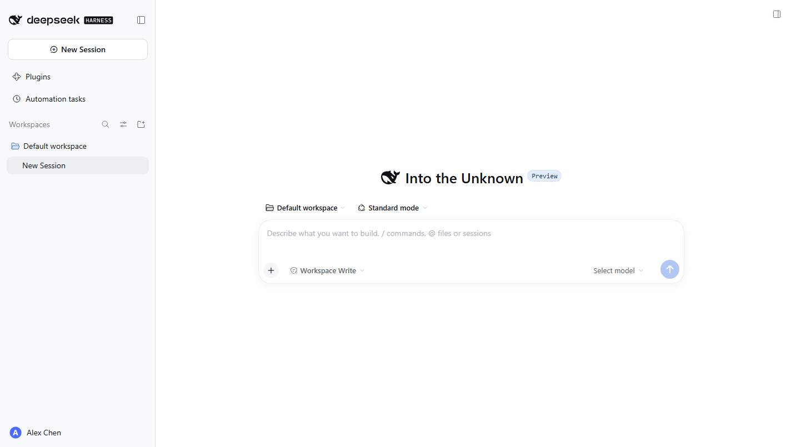
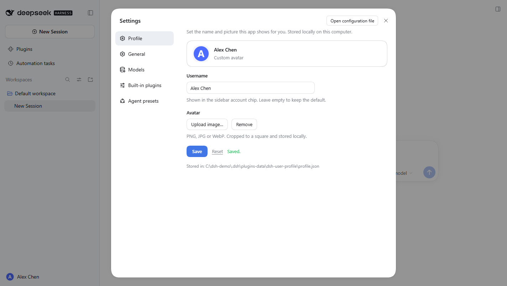

<div align="center">

# dsh-user-profile

**给 DeepSeek Harness 一个属于你自己的名字和头像。**

在 **设置 → 个人资料** 里改用户名、传头像，保存后立刻显示在侧边栏左下角的账号位置。

*A local display profile for [DeepSeek Harness](https://github.com/deepseek-ai/deepseek-harness): set your own name and avatar, shown in the sidebar account chip.*

[](https://github.com/deepseek-ai/deepseek-harness)
[](./LICENSE)
[](https://github.com/topics/dsh-plugin)
[](https://github.com/deepseek-ai/deepseek-harness)
[](https://github.com/xbbkok/dsh-user-profile/actions/workflows/ci.yml)
[](https://github.com/xbbkok/dsh-user-profile/releases)
[](https://github.com/xbbkok/dsh-user-profile/stargazers)

**中文** · [English](./README.md)

</div>

---



## 为什么需要它

DSH 左下角的账号区域读的是 **DeepSeek Platform 的登录资料**——只读；没登录时更会退化成一个"更多"按钮。也就是说，这个位置显示的从来不是你愿意让它显示的东西。

**dsh-user-profile** 补上这一块：名字和头像存在本机，覆盖显示在同一个位置。账号菜单（设置 / 意见反馈 / 退出登录）照常工作，只是那张脸换成了你的。

| | |
|---|---|
| 🪪 **用户名** | 最多 32 字符，中英文都行；留空即回到默认 |
| 🖼️ **头像** | 上传 PNG / JPG / WebP，自动居中裁方、缩到 192×192 再存；也可一键移除 |
| 👀 **实时预览** | 改的同时就能看到最终效果，保存后侧边栏立即更新 |
| 🔄 **可还原** | 点「重置」清空资料，侧边栏原样回到平台账号 |
| 🌐 **跟随语言** | 中文界面显示「个人资料 / 用户名 / 头像」，英文界面显示 *Profile / Username / Avatar* |
| 💾 **只存本机** | 不上传、不同步，数据就在你自己的 `~/.dsh` 下 |



## 安装

### 方式一：作为 bundle 安装（推荐）

包内已声明 `dsh.bundle.patch`，官方 CLI 会顺带把插件行挂进 profile：

```bash
dsh plugin --profile web add github:xbbkok/dsh-user-profile
```

桌面版把 `web` 换成 `desktop`。装完重开一次 DSH 即可看到「设置 → 个人资料」。

### 方式二：从本地路径挂载（开发 / 离线）

在 profile 的 `cordis.patch.yml` 末尾加一行 `insert`（注意加载器用 `import()`，**必须是 `file://` URL**，裸 Windows 路径会静默不加载）：

```yaml
- insert:
    - id: dsh-user-profile
      name: 'file:///C:/path/to/dsh-user-profile/lib/index.js'
```

profile 的 `cordis.patch.yml` 位置：

| 版本 | 路径 |
| --- | --- |
| 桌面版 | `%USERPROFILE%\.dsh\profiles\desktop\cordis.patch.yml` |
| Web 版 | `%USERPROFILE%\.dsh\profiles\web\cordis.patch.yml` |

这一行按 `id` 覆盖同名行，所以即使之后又用 bundle 方式安装，也不会重复挂载。

## 使用

1. 左下角头像 → **设置**（快捷键 `Ctrl+Alt+,`；英文界面 *Settings*）。
2. 左侧第一项 **个人资料**（*Profile*）。
3. 填名字、选头像，点 **保存**。
4. 想恢复平台账号原样，点 **重置**。

## 它把数据放在哪

```
%USERPROFILE%\.dsh\plugins-data\dsh-user-profile\profile.json
```

```json
{
  "version": 1,
  "name": "示例用户",
  "avatar": "data:image/png;base64,…",
  "updatedAt": "2026-01-01T00:00:00.000Z"
}
```

同一个目录里的 `heartbeat.txt` 每次宿主插件挂载时重写——"插件到底加载了没有"可以直接查证，不用猜。

头像存成 **data URL**（PNG，192×192，通常 10–40 KB）。选图时在浏览器里裁剪压缩，**不会**原图落盘。

## 接口

宿主半边在 DSH 的 Web 服务上注册同一来源的两个方法：

| 方法 | 路径 | 说明 |
| --- | --- | --- |
| `GET` | `/user-profile` | 返回 `{ ok, profile, storagePath }` |
| `POST` | `/user-profile` | Body `{ name?, avatar? }`（省略的字段保持原值；`avatar: null` 清空） |

写入做了三层约束：名字按 Unicode 码点限制 32 且去掉控制字符；头像只接受 PNG/JPEG/WebP 的 `data:` URL（**拒绝 SVG**——它是可执行标记，不是图片）并限长；带 `Origin` 且与本机 Host 不一致的写请求返回 403，避免被其他网页跨站改写。

## 实现

一个包、两半，跟 DSH 其他 UI 插件同构：

- **`lib/index.js`（宿主 / Node）** — 注册 `/user-profile`，做校验、原子落盘（临时文件 + rename）、写心跳。只依赖 `node:fs`，没有第三方运行时依赖。
- **`lib/client.js`（浏览器）** — 通过 `ctx.slots.register({ name: 'settings.section', id: 'profile', order: -30 })` 注册设置页；再把头像和名字覆盖到 `button[data-signed-out]` 这个账号触发器上。

几个刻意的取舍：

- **不改别人的组件。** 账号按钮属于 `dsh-client-ui-settings-account`，直接改包既脆弱又会被更新覆盖。这里只做 DOM 装饰：记住原生子节点的 `display` 后隐藏，插入自己的头像和名字；清空资料时原样还原。`MutationObserver` 负责在 React 重渲染后补回来，写入幂等——不会因为自己的改动把观察器喂成死循环（单测里专门验了）。
- **失败不外溢。** 拿不到 `webServer`、目录不可写、路由注册抛错，都只写一条 warn；插件加载失败不会把整棵插件树带崩。
- **语言跟随应用。** 字典用 `ctx.locale.register('user-profile', { zh, en })` 注册，`ctx.locale.bind()` 取值，跟随 DSH 自己的语言设置。
- **零构建。** `lib/*.js` 就是可读的 ESM 源码，`window.__ModuleLoader__.load()` 的工厂格式由客户端模块系统直接消费，没有 bundler、没有 `postinstall`。

## 兼容性

- DSH **0.2.x**（`@deepseek-ai/dsh >= 0.1.2-rc.1`）。
- 桌面版与 Web 版都适用；依赖的槽位 `settings.section` 与账号按钮的 `data-signed-out` 属性自 0.1.x 起未变。
- 只在**侧边栏**和**设置页**做展示覆盖，不碰登录态、计费、模型调用。

## 已知限制

- 改的是**显示资料**，不是 DeepSeek Platform 上的真实账号资料。
- 资料按机器保存，不跨设备同步。
- 若将来 DSH 改掉 `button[data-signed-out]` 这个属性，侧边栏覆盖会静默失效（设置页里的功能不受影响）。
- 侧边栏覆盖是对别人组件的 DOM 装饰，不是官方插槽；能做的防御都做了，但它本质上是"贴上去"的。

## 开发与测试

```bash
npm install   # 只装 jsdom，用于无浏览器环境跑客户端半边
npm test
```

19 项检查：宿主校验、原子落盘、HTTP 处理器（GET / POST / 非法 JSON / 超长名 / SVG 伪装 / 跨站写入 / 错误方法）、客户端产物可加载、槽注册与中文标签、账号按钮的覆盖与还原、折叠态、观察器收敛。

改 `lib/client.js` 后页面会热换；改 `lib/index.js`（宿主半边）需要重启 DSH 才会重新 import。

## 卸载

删掉 profile `cordis.patch.yml` 里那行 `dsh-user-profile`（或从 `dsh.profile.bundles` 移除），再删 `%USERPROFILE%\.dsh\plugins-data\dsh-user-profile\`，刷新页面即可。

## License

[MIT](./LICENSE) © 2026 xbbkok
